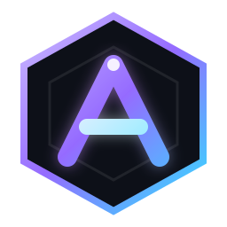

# Argon UI

`argon-ui.luau` is the local UI dependency for the menu. Keep it in the same executor workspace as the script you run.

- `menu.luau` remains the original menu entry.
- `menu-argon.luau` is the separate Argon UI migration build.

The migration build downloads the latest library from the public `JirkaachS/argon-ui` GitHub repository. A neighboring `argon-ui.luau` remains available as an offline fallback.

## Hosted Usage

```luau
local Argon = loadstring(game:HttpGet(
    "https://raw.githubusercontent.com/JirkaachS/argon-ui/main/argon-ui.luau"
))()
```

`menu-argon.luau` already uses this hosted endpoint automatically.

## Design

- Rayfield-compatible window, tab, control, notification, flag, and configuration APIs.
- Orion-style section grouping for large feature sets.
- WindUI-inspired glass surfaces, spacious controls, search, gradients, and motion.
- MacLib-inspired compact navigation, pill states, restrained window chrome, and responsive collapse.
- Refined rounded Lucide-style navigation icons with scalable geometry and no operating-system glyph fallback.
- Drag-resizable windows with a viewport-aware `560 x 400` minimum size.
- A `SECTIONS` navigator for direct jumps inside long tabs.
- Clipped and truncated control content so long keys and webhook URLs stay contained.
- Draggable player-list and active-keybind overlays that remain available while the main window is hidden.
- A staged orbit loader plus animated, direction-aware tab transitions.



## Supported API

- `CreateWindow`, `CreateTab`, and `CreateSection`
- `CreateButton`, `CreateToggle`, `CreateSlider`, and `CreateDropdown`
- `CreateInput`, `CreateKeybind`, and `CreateLabel`
- Element `Set` methods and dropdown `Refresh`
- `Notify`, `SaveConfiguration`, `LoadConfiguration`, and `Destroy`
- `SetPersistenceReady`, `GetFlagValue`, and deferred flag hydration
- `Window:SetLogo`, `Window:SetTheme`, and `Window:SetTitle`
- `Window:SetPlayerListVisible`, `Window:SetKeybindListVisible`, and matching toggle methods
- `Rayfield.Flags` compatibility for live profile resets
- Runtime themes, modal dialogs, descriptions, tooltips, locked states, and element visibility
- `CreateColorPicker`, `CreateParagraph`, `CreateTelemetryCard`, `CreateDivider`, and `CreateSpace`
- WindUI-style aliases such as `Tab:Section()`, `Section:Toggle()`, and `Section:Colorpicker()`

The interface toggles with `Insert`. Press `/` while it is open to focus the active-tab search. Overlay visibility can be configured with `PlayerList` and `KeybindList` in `CreateWindow`; both default to enabled.

## Browser Preview

Open `argon-ui-preview.html` in any modern browser to preview the visual system without Roblox. The standalone preview includes responsive desktop/mobile layouts, tab search, toggles, sliders, dropdowns, inputs, keybind capture, buttons, and animated notifications.

- Press `/` to focus search.
- Press `Insert` to hide or restore the preview.
- Resize the browser to inspect the compact navigation layout.

## WindUI Extensions

```luau
local Window = Argon:CreateWindow({
    Name = "Argon Utility",
    Theme = "Midnight",
    Logo = "rbxassetid://YOUR_LOGO_ASSET_ID",
    PlayerList = true,
    KeybindList = true,
})

local Tab = Window:CreateTab("Settings", "settings")
local Section = Tab:Section({ Title = "Appearance" })

Section:Dropdown({
    Name = "Theme",
    Options = Argon:GetThemes(),
    CurrentOption = { "Midnight" },
    Callback = function(value)
        Window:SetTheme(value[1])
    end,
})

local Accent = Section:Colorpicker({
    Name = "Accent color",
    Color = Color3.fromRGB(153, 112, 255),
    Callback = function(color)
        print(color)
    end,
})

Accent:SetTooltip("Choose a custom accent")
Accent:Lock("Premium")
Accent:Unlock()

Window:Dialog({
    Title = "Save changes?",
    Content = "Your interface settings will be persisted.",
    Buttons = {
        { Title = "Cancel" },
        { Title = "Save", Variant = "Primary", Callback = function() end },
    },
})

-- Replace the logo at runtime with an asset ID or Roblox image URI.
Window:SetLogo("rbxassetid://YOUR_OTHER_LOGO_ASSET_ID")

local Pause = Section:Keybind({
    Name = "Pause combat",
    CurrentKeybind = "P",
    Toggle = true,
    OnPressed = function(key, active)
        print(key, active)
    end,
})

Pause:SetActive(true)
Window:TogglePlayerList()
Window:ToggleKeybindList()
```

Built-in themes are `Argon`, `Amethyst`, `Midnight`, `Emerald`, and `Rose`. Add custom palettes with `Argon:AddTheme(name, palette)` and apply them using `Argon:SetTheme(name)` or `Window:SetTheme(name)`.

## Configuration Persistence

Flag values are written to `FolderName/FileName.rfld` roughly a third of a second after a change, and `LoadConfiguration` restores them.

- Autosave stays gated while the UI is built, then enables automatically after `LoadConfiguration` or shortly after `CreateWindow`. Calling `SetPersistenceReady(true)` yourself is still supported but no longer required.
- Restoring a value applies it silently and then invokes the control callback exactly once, so a saved value identical to the element default still reapplies its behavior instead of only updating the visuals.
- Values whose control does not exist yet are retained, applied when that flag registers later, and preserved by `SaveConfiguration`, so conditionally created controls no longer lose their settings.
- Dropdowns remember the requested selection even when their option list is empty or filtered, and `Refresh` reapplies it once the option appears.

```luau
Argon:LoadConfiguration()          -- restores values and enables autosave
Argon:GetFlagValue("MyToggle")     -- reads a live or still-pending value
Argon:SaveConfiguration()          -- returns ok, path or ok, reason
```

Every control that should persist needs a `Flag`. Controls without one stay transient by design.
