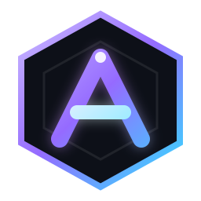

# Argon UI

Argon UI is a standalone Roblox UI library in a single Luau file. No dependencies, no host script: load it, create a window, add controls.

**Documentation: https://jirkaachs.github.io/argon-ui/**

```luau
local Argon = loadstring(game:HttpGet(
    "https://raw.githubusercontent.com/JirkaachS/argon-ui/main/argon-ui.luau"
))()

local Window = Argon:CreateWindow({
    Name = "My Hub",
    ConfigurationSaving = { Enabled = true, FolderName = "MyHub", FileName = "config" },
})

local Tab = Window:CreateTab("Main", "zap")
Tab:CreateSection("Farming")
Tab:CreateToggle({
    Flag = "AutoFarm",
    Name = "Auto farm",
    Callback = function(enabled) print("auto farm:", enabled) end,
})

Argon:LoadConfiguration()
```

Keep a copy of `argon-ui.luau` beside your script if you want an offline fallback for the hosted URL.

## Features

- Tabbed window with sections, per-tab search, and a `SECTIONS` navigator for long pages
- 18 controls, including progress bars, steppers, segmented pickers, text areas, and data lists
- Configuration persistence with verified writes, deferred flag hydration, and change listeners
- Five built-in themes plus custom palettes, applied live
- Draggable player and keybind overlays that can stay on screen while the window is hidden
- Modal dialogs, notifications, tooltips, descriptions, locked states, and element visibility
- Drag-resizable window with a `560 x 400` minimum and responsive sidebar collapse
- Vector icon atlas with no operating-system glyph fallback
- Rayfield-style API shape, so existing menus usually only need their loader swapped

## Controls

| Group | Controls |
| --- | --- |
| Input | `Toggle`, `Input`, `TextArea`, `Keybind` |
| Choice | `Dropdown`, `Segmented`, `ColorPicker` |
| Numeric | `Slider`, `Stepper` |
| Action | `Button` |
| Display | `ProgressBar`, `List`, `TelemetryCard`, `Label`, `Paragraph` |
| Layout | `Section`, `Divider`, `Space` |

Every `Create*` method has a prefix-free alias (`Tab:Toggle`, `Section:Dropdown`, and so on).

## Rows

A tab with ninety controls is a single column you scroll blind, and the related ones end up screens apart. `CreateRow` splits the section body into equal columns and hands controls out round-robin, so the pair you build together sits side by side.

```luau
local row = Tab:CreateRow({ Columns = 2 })
row:CreateToggle({ Flag = "Chams", Name = "Chams", CurrentValue = false })
row:CreateSlider({ Flag = "ChamsOpacity", Name = "Opacity %", Range = { 5, 100 }, Increment = 1, CurrentValue = 60 })

-- or, when the pairing matters more than the balance
row:Use(2):CreateToggle({ Name = "Pin me right", CurrentValue = false })
```

`Columns` accepts 1 to 4 and may be passed bare (`Tab:CreateRow(2)`). `Spacing` sets the gap, and `MinColumnWidth` (default 200) is the width below which the columns collapse back into one stack — so a resized window and a phone get a readable layout from the same calls. Rows carry the same shorthands as sections, join the owning section for search, and hide themselves when everything in them is filtered out.

Best suited to compact controls: toggles, sliders, steppers, keybinds, colour pickers, buttons, inputs, dropdowns and short segmented pickers. Lists and text areas want the full width.

## List row actions

A list row can carry several buttons instead of one, which beats a selectable list plus a stack of buttons that act on "whatever is selected".

```luau
Tab:CreateList({ Name = "Profiles", Items = {
    { Title = "Mining", Description = "saved snapshot", Actions = {
        { Label = "Load",   Callback = function(row) load(row.Title) end },
        { Label = "Rename", Style = "warning", Callback = function(row) rename(row.Title) end },
        { Label = "Delete", Style = "danger",  Callback = function(row) remove(row.Title) end },
    } },
} })
```

`Style` accepts `danger` and `warning`, or pass an explicit `Color`. A single `Action = "Load"` with a row-level `Callback` still works.

## Persistence

Any control given a `Flag` is saved to `FolderName/FileName` shortly after it changes, and each write is read back to confirm it landed.

```luau
Argon:LoadConfiguration()             -- restores values, reapplies callbacks, enables autosave
Argon:GetFlagValue("AutoFarm")
Argon:SetFlagValue("FlySpeed", 220)
Argon:OnFlagChanged(function(flag, value) print(flag, value) end)
Argon:GetConfigurationStats()
Argon:ResetConfiguration()
```

Restored values always run their callback once, even when the stored value equals the control default, and values whose control does not exist yet are retained rather than dropped.

## Overlays

The player list and active-keybind panels are draggable and can be pinned so they remain visible after the main window is hidden.

```luau
Window:SetOverlaysAlwaysVisible(true)
Window:ToggleOverlaysAlwaysVisible()
Window:TogglePlayerList()
Window:ToggleKeybindList()
```

`Window:CreateLibrarySettings(tab)` adds theme, overlay, pin, logo, and transition controls in one call.

## Tests

`tests/` runs the real library outside Roblox against a small Roblox API sandbox. Install [Lune](https://github.com/lune-org/lune), then:

```sh
lune run tests/run.luau
```

The suite covers control behavior, the configuration round-trip, deferred flag hydration, autosave timing, pinned overlays, themes, dialogs, and window controls. See `tests/README.md`.

## Browser preview

Open `argon-ui-preview.html`, or the hosted [preview](https://jirkaachs.github.io/argon-ui/preview.html), to explore the visual system without Roblox. Press `/` to focus search and `Insert` to hide or restore the window.

## Themes

Ten built-in palettes: `Argon`, `Amethyst`, `Midnight`, `Emerald`, `Rose`, `Slate`, `Ember`, `Nord`, `Mono`, `Ocean`. Register your own with `Argon:AddTheme(name, palette)` and apply it using `Argon:SetTheme(name)` or `Window:SetTheme(name)`.

Every control the library builds re-themes itself, including ones that were hovered or mid-animation when the theme changed. If your script builds its own frames outside the library, read the live palette instead of baking in colours:

```luau
local rowColour = Argon:GetColor("Surface")
local hoverColour = Argon:GetColor("Hover")

local unbind = Argon:OnThemeChanged(function(palette, themeName)
    row.BackgroundColor3 = palette.Surface
end)
```

`Argon:GetColor(key, fallback)` resolves a single palette key, `Argon:GetPalette()` returns a detached snapshot, and `Argon.Palette` is the live table. Keys: `Background`, `Window`, `Sidebar`, `Surface`, `Hover`, `Active`, `Input`, `Border`, `BorderSoft`, `Text`, `Muted`, `Dim`, `Accent`, `AccentLight`, `AccentDark`, `Success`, `Warning`, `Danger`.

## Icons

Icons come from the official [Lucide](https://lucide.dev) set, fetched once and cached on disk, with a bundled atlas as an offline fallback.

```luau
Window:CreateTab("Mining", "pickaxe")
local icon = Argon:GetIcon("shield-check")   -- { Image, ImageRectOffset, ImageRectSize }
```


